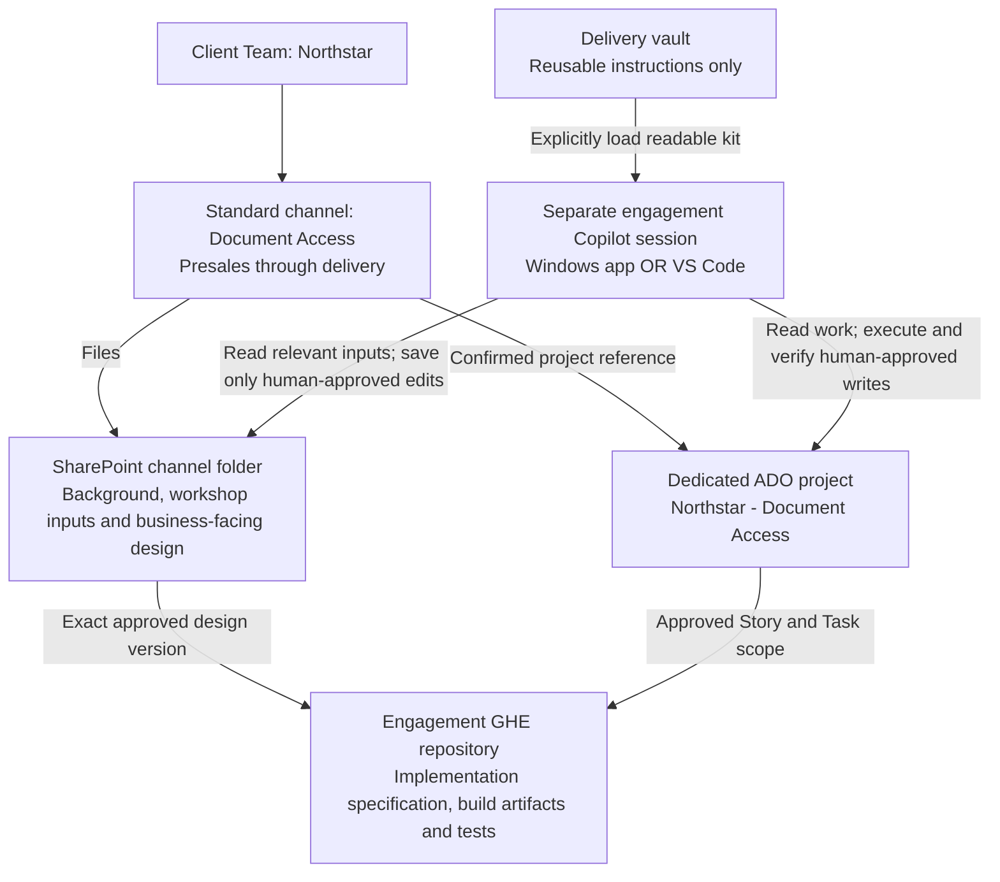
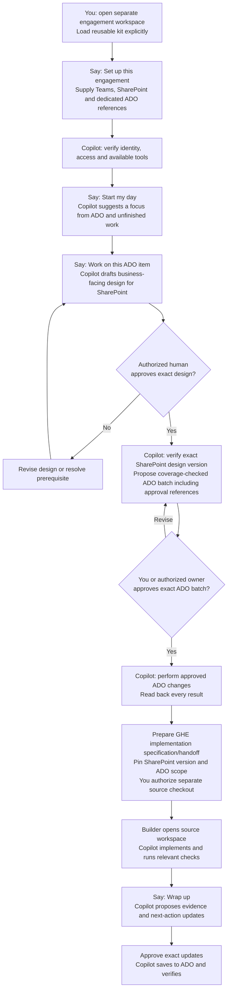

# Visual walkthrough: who runs what, where and how

## What actually runs

**You start the engagement in Teams and run delivery assistance by talking to
Copilot in a separate engagement workspace**, either in the GitHub Copilot
Windows app or in VS Code. You do not run project work in the delivery-vault
checkout. This document is an explanation, not a program, a button, a scheduled
job or an executable walkthrough.

A **skill** is a set of instructions that Copilot reads when handling your
request. It is not a separate application. Copilot uses the tools available in
your interface to read documents and ADO, draft designs, and perform specifically
approved changes. A skill does not install those tools or grant access.

The four phrases below are conversational entry points, not required command
syntax. Copilot should select the matching skill when it is available. If it
does not, explicitly ask it to read the linked skill and its supporting rules.
Do not assume automatic discovery or identical integrations across interfaces.

| Who / component | Where | Responsibility |
|---|---|---|
| Engagement owner / administrator | Client Team and standard engagement channel | Follow onboarding checklist, curate workshop inputs, confirm actual resources and permissions |
| You, the delivery practitioner | Separate engagement folder/session in either interface | Start work, load the shared kit, supply context and coordinate approvals |
| Authorized business / technical approver | Review conversation or existing approval channel | Approve the exact design and relevant business rulings; you cannot approve on their behalf without authority |
| Copilot | The session you opened | Follow the skill, use verified tools, draft proposals, stop at approval gates and verify approved changes |
| Delivery vault | This repository, read as reusable guidance | Skills, blank templates and rules only; no project context, even in ignored folders |
| SharePoint | Client site, normal engagement channel folder | Curated project documents and authoritative business-facing designs |
| ADO | Dedicated project for this engagement | Hold actionable requirements, acceptance criteria, Stories/Tasks, state, risks, decisions and evidence |
| Engagement GHE repository | Authorized source checkout when implementation is needed | Implementation specification/handoff, build artifacts and tests |
| Builder: you or a teammate, assisted by Copilot | A separately authorized source workspace | Implement and check the approved scope using the handoff |

One person can fill several human roles if authorized. Copilot never becomes
the business approver merely because it wrote the design.

## Start in Teams, then open the engagement workspace

The approved client Team is named for the client, for example **Northstar**.
Its standard engagement channel is named for the opportunity/project, for
example **Document Access**. Keep it through presales and delivery. Spaces are
fine; no GET AI prefix or invented engagement ID is needed. The channel's Files
location is a folder in the client site's default SharePoint library, **not a
new project library**. A separate library or restricted Team/site is an explicit
exception. See [structure, naming and access](operating-model.md).



The owner requests missing resources through the approved admin process.
Creating the channel does **not** create an ADO project, GHE repository or
automation. Team participation is for assigned people; ordinary documents have
governed GET AI-wide read access with restricted exceptions. Administrators must
verify that access model; it does not follow automatically from Team creation.
Client-facing publication uses a separately controlled approved area.

| Windows app | VS Code |
|---|---|
| Open an approved engagement working folder as the session workspace, outside the vault. Enter the request in that session's chat. | Open the approved engagement working folder, outside the vault, and Copilot Chat in an agent-capable mode. |
| Explicitly load the intended skill and linked rules from the readable shared kit; verify this works in that session. | Explicitly load the same kit; verify this version/settings supports the chosen mechanism and linked resource reads. |

If loading fails, open/attach the relevant
[`SKILL.md`](../.github/skills/delivery-setup/SKILL.md) and ask Copilot to read
its linked rules without changing the working folder to the vault. If that is
unavailable, request an approved readable kit distribution preserving its links.
See [loading and capability checks](../README.md#loading-skills-in-either-interface).
The kit is currently local and unpublished: it is not automatically available
on a teammate's machine. Sharing/publication requires separate authorization.
Keep connection metadata and temporary project drafts in the authorized
engagement folder, never in the vault. No source repository is needed in presales.

## The process at a glance



Setup is normally needed once per engagement/interface, then rechecked when
access or configuration changes. **Start my day is optional**: if you already
know the item, go straight to **Work on this**. These are not four commands you
must run in order every time. Approving a design does not approve backlog writes,
and approving backlog writes does not start a build.

## What you type and what happens

These are example prompts, not instructions to execute fictitious ADO writes.
Replace resource references with confirmed real ones for a real engagement.
All engagement names, item IDs and outcomes below are fictitious. A named owner
curates permitted workshop inputs in SharePoint; meeting recordings/transcripts
are not assumed to land in the project folder automatically.

| Step | Where you are | Example of what you type | What Copilot does / where it stops |
|---|---|---|---|
| Connect | Engagement session | "Set up Northstar / Document Access. Here are the client Team, SharePoint folder and dedicated ADO project references. We have no source repository yet. Check access; do not make changes." | Uses [delivery-setup](../.github/skills/delivery-setup/SKILL.md); confirms identity, actual resources/process and capabilities. Missing required resources go to an administrator. No source repo is required for discovery. |
| Choose work | Engagement session | "Start my day. Check my assigned work in the configured engagements and relevant unfinished drafts/source changes." | Uses [delivery-day](../.github/skills/delivery-day/SKILL.md); reads only authorized configured scopes and suggests a focus. Does not reprioritize or change state. |
| Design | Engagement session | "Work on item 110 in Northstar - Document Access. Use the relevant SharePoint workshop inputs and propose a design first. Do not create backlog items or build." | Uses [delivery-work](../.github/skills/delivery-work/SKILL.md); drafts outside the vault for SharePoint. Uploads/edits need scoped approval and saved-version verification. |
| Review design | Review with authorized approver | "I approve this exact SharePoint design version for the stated scope. Propose backlog coverage and the ADO approval references; do not write to ADO yet." | Verifies document identity/version, approver and evidence. A colleague's approval is not invented. Latest-document access alone is insufficient. |
| Review backlog | Engagement session | "Show the existing parent and child work you will reuse, any gaps, and the exact proposed changes." | Shows requirement-to-design-to-Story/Task-to-verification coverage and a scoped batch. Stops for write approval. |
| Authorize ADO batch | Engagement session | "I approve only the ADO operations in this displayed batch. Execute and verify them; do not build." | Uses an available verified capability within approval; reads back each result. If unavailable or failed, reports the blocker, not success. |
| Prepare build | Engagement session and authorized GHE checkout | "Prepare the implementation specification/handoff for these approved items in the engagement build repository. Do not start implementation." | References the approved SharePoint version, ADO scope, source/environment and checks. Missing repository is an admin handoff. Creation, Git publication and transfer access need separate approval. |
| Build | Separate source workspace | "I authorize implementation of the scope in this handoff in this source workspace. Read the pinned design and current ADO items first. No deployment, commit or push." | Builder's Copilot verifies access and readiness, then implements and checks only that scope. Stops on design drift or changed scope. |
| Wrap | Build session, with readable wrap-up instructions and verified ADO tools | "Wrap up. Show verified results and propose the ADO evidence and next-action updates. Do not mark Done or deploy." | Uses [delivery-wrap-up](../.github/skills/delivery-wrap-up/SKILL.md); proposes updates. Saves only after scoped approval and verifies each result. |

Natural-language approval must identify the actual displayed scope/revision; the
example wording alone is not blanket authorization. Business rulings, risk
acceptance, completion, Git publication and live changes remain separate gates.

## The workspace change is deliberate, not automatic

```mermaid
sequenceDiagram
    actor User as You / authorized practitioner
    participant Kit as Reusable delivery kit
    participant Engagement as Copilot in engagement workspace
    participant SP as SharePoint
    participant ADO as Azure DevOps
    participant Source as Copilot in source workspace
    User->>Engagement: Set up using actual Teams, SharePoint and ADO references
    Engagement->>Kit: Explicitly read skill, rules and templates
    User->>Engagement: Work on this item; design first
    Engagement->>SP: Read relevant curated inputs
    Engagement->>ADO: Read requirements and existing work
    Engagement-->>User: Draft design for review
    User->>Engagement: Approve exact SharePoint save operation
    Engagement->>SP: Save and verify design version
    User->>Engagement: Authorized design approval for that exact version
    Engagement-->>User: Coverage and exact proposed ADO batch
    User->>Engagement: Approve exact ADO batch
    Engagement->>ADO: Apply approved changes and read back
    Engagement-->>User: Verified IDs and GHE handoff proposal
    Note over User,Source: You open or explicitly authorize the separate source workspace
    User->>Source: Supply readable pinned handoff and authorize build scope
    Source->>Kit: Load readable relevant rules
    Source->>SP: Read exact approved design version
    Source->>ADO: Re-read scope, approval evidence and prerequisites
    Source-->>User: Implementation and observed check results
    User->>Source: Approve exact wrap-up updates
    Source->>ADO: Save evidence and next action; read back
```

There is **no automatic session creation or background handoff** in this kit.
You open the source repository in the chosen interface, or explicitly authorize
an available tool to open it. The builder may be you or a teammate. Provide the
handoff and readable relevant rules; a new session does not automatically inherit
the engagement conversation or shared skills. It must load the readable
reusable kit and exact approved SharePoint design version. Do not copy client
context into the vault or internal documents into client source to make loading
easier. The implementation specification adds execution detail, not another
authoritative business design.

If the source session lacks ADO access, return its verified results to an
authorized engagement session for review and approved bookkeeping. Never claim an
update was saved just because the builder supplied a summary.

## What is available now versus still to verify

The local kit provides instructions and templates, not a deployed workflow
engine. Windows app GHE/ADO read access was verified during onboarding.
ADO writes remain untested. Teams/SharePoint integration, document writes and
exact-version access, tenant permissions, and kit loading in a separate engagement
workspace remain to be verified. VS Code verification is deferred, not a blocker
to documentation work. Explicitly loading `delivery-work` while maintaining
this kit does not verify automatic selection or all four skills/interfaces.
No project resources, ADO work, design uploads, handoffs or builds in this example
have been executed. This vault session is for reusable kit authoring only.

## Worked example: why the coverage check exists

The remaining example shows what Copilot should check inside **Work on this**.
It is not a second procedure you need to run manually.

### Setup and design

The business supplies the Northstar Team, Document Access standard channel,
actual SharePoint folder and dedicated Northstar - Document Access ADO project.
A named owner has checked workshop-input consent, access and retention.
There is no source repository yet. Setup confirms identity and the actual process;
this example uses Epic / Feature / User Story / Task. It finds Epic 100 and two
candidate Features.
The user chooses existing Feature 120, "Document access", after reviewing scope.
Setup discovers existing Story 130 and Task 131 before proposing anything new.
No project, custom type or parallel GitHub board is created.

Requirement 110 asks for authorized staff to retrieve a document while denied
access discloses no content. The design describes the permission boundary,
existing interface reuse, failure behavior and independent verification.
After an approved upload and read-back, the owner identifies exact SharePoint
design version D1. An authorized approver approves that version; a scoped ADO
update records its document identity, version, approver and approval evidence.
If D1 cannot remain readable to the builder, the build handoff is not-ready.

### Coverage before a mutation proposal

| Requirement / outcome | Approved design | Existing or proposed Story / Tasks | Verification / planned evidence |
|---|---|---|---|
| 110: authorized retrieval | D1 access contract | Reuse Story 130 / Task 131 after checking coverage | Synthetic document returned to allowed role; test reference on 130 |
| 110: deny without content | D1 permission boundary | Extend 130 criteria if approved; propose Task A under 130 | Denied role receives no content; negative-test evidence on 130 |
| 110: release safely | D1 release approach | Propose Task B under 130 for applicable configuration, release check and docs | Confirm environment/configuration, release check and operator guidance in ADO |

The review checks existing criteria/tasks against all outcomes rather than
assuming that Story 130 covers everything. No estimates or assignees are invented.
Task B depends on permission verification and an authorized release environment.
If that environment is missing, B is explicitly not-ready; the user may approve
its creation as a blocked planning item, not its execution. Exact state/fields
come from the discovered process, not this example.

The user approves a batch naming the criteria change and creation/linking of A
and B under 130, with B's unresolved prerequisite disclosed. No new parent is
needed. Each change must be read back, including parent and dependency relations.
The coverage matrix is a review artifact, not a running status table.

### Partial failure and handoff resume

Suppose A returns ID 132 and read-back confirms its parent is 130. Creation of B
times out. Stop: do not recreate both tasks, delete 132 or roll back the Story.
Read known IDs/revisions and search narrowly under 130 for B. If B is found as
133, verify its fields and parent. If its approved dependency link is absent,
resume only that missing operation after confirming scope and revisions still
match. If it is unclear whether B exists, seek resolution before another create.
Persist verified IDs and the unresolved next action on the relevant ADO item
only with authorization.

When implementation is authorized, an administrator provides the engagement GHE
repository, for example `northstar-document-access`. The implementation
specification/handoff lives there, not in the vault, and references exact
SharePoint design version D1, its ADO approval evidence, ADO 130/131/132/133,
source revision, environment and credential-store references. Once authorized
Git publication and access prerequisites are satisfied, the builder receives
the precise handoff revision. They open a separately authorized build workspace,
load readable instructions and re-read current ADO criteria, dependencies and
unfinished local changes. They do not build in the vault or trust stale handoff
state. An inaccessible approved version requires owner resolution; a latest link
or private local path is not a substitute. Any necessary client-facing derivative
requires explicit approval and traceability to the approved version.

If SharePoint receives a permission-design draft D2, it does not silently replace
approved D1. For a required change, pause affected work, obtain design
approval, rerun coverage/duplicate checks and approve any revised ADO batch.
Do not silently expand the original approval.

Wrap-up posts only observed checks and the next action to ADO after scoped
approval and read-back. Passing the negative test is not permission to deploy,
accept risk or mark Done. A proposed lesson about denied-content testing is
anonymized and confirmed before saving; it is not automatically a standard.
